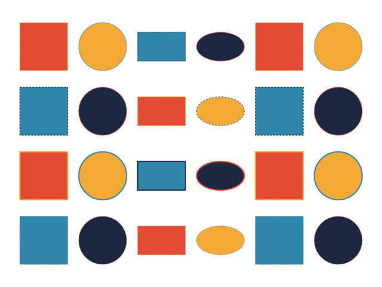

# Support Repo

<!-- Constants -->
Support branch of repository for:
<!-- Link to PR -->
- [awesome-copilot pull request](https://github.com/) <!-- github.com/<owner>/<repo>/pull/<[0-9]+> -->
- `Ctrl + click` View illustration [index.html](https://jhauga.github.io/support-repo/docs/)
<!-- git commit -m "undeploy: use htmlpreview for index.html" -->
<!--
- `Ctrl + click` Navigate new pages [index.html](https://jhauga.github.io/htmlpreview.github.com/?https://raw.githubusercontent.com/jhauga/support-repo/refs/heads/plugin-adobe-after-effects/docs/index.html)
-->

<!-- NOTE - leave formatter_1 and formatter_2 for semi-automated task -->
<!--
IMPORTANT - mind description, and change first line for 1 to sentence description.
## Description
-->
<!-- formatter_1 -->
Plugin to help write, edit, or debug Adobe After Effects scripts, expressions, extensions, plugins, and MCP servers, or to build automated tools that assemble and render compositions in Adobe After Effects.

Support branch for new plugin adobe-after-effects.

## Test Conditions

Full [test results](https://github.com/jhauga/support-repo/tree/plugin-adobe-after-effects) (*ctrl + click*) at support repo.

### Evaluation Context

- **Session Target**: Copilot CLI
- **Agent**: Agent
- **Model**: Claude Haiku 5.5
  - **Thinking Effort**: Medium
- **Number of Prompts**: 1
- **Post Edits**: none
<!-- NOTE: change if updated -->
### Copilot Pro+ Plan Credit Usage

- **Start Credits**: 5%
- **End Credits**: 5%

### Prompt

```text
Use the adobe-after-effects-scripting and adobe-after-effects-integrations skills to build "Acme Sting", a small Adobe After Effects extension that makes a brand logo animation for Acme Corp, the kind that closes a TV commercial, and a documentation site for it in docs/ that GitHub Pages can serve.

The logo (built in After Effects, no imported artwork)
1. An ES3 ExtendScript, acme-sting/jsx/acme-sting.jsx, draws the Acme Corp logo in After Effects from shape and text layers, in a precomposition named "Acme Logo": a simple mark (for example a circle or rounded square holding a letter A made from shape paths) beside the word ACME, with the tagline "Quality you can count on" below. Use a font that ships with the operating system (for example Arial); put no font files in the repository. The colors, the word, and the tagline are settings.

The animation
2. The same script builds a 1920 x 1080, 30 fps composition named "Acme Sting", 6 seconds long by default, that reveals the logo with the most familiar logo-reveal effects. Each effect is a setting that turns on or off, with one or two values:
   - a scale-up with an overshoot bounce, written as an expression rather than hand-placed keyframes;
   - a fade in;
   - the mark spinning in;
   - the mark's outline drawing on with Trim Paths;
   - a light sweep across the logo (CC Light Sweep);
   - a glow;
   - a drop shadow;
   - the word ACME typing on;
   - the tagline sliding up;
   - a lens flare or a particle burst at the moment of the reveal;
   - a gradient background that drifts slowly;
   - an end card reading "example.com" for the last second.
   Apply effects by match name, looked up once in app.effects. If an effect is missing, skip it and say so in the result rather than failing.
3. Presets: at least three named combinations (for example Classic, Shine, and Bounce), plus a settings object that overrides any value in a preset.
4. The script runs from the panel in item 5 and from outside After Effects with AfterFX.exe -s "var stingJob = { ... }; $.evalFile('...');". Given a job (preset, overrides, render on or off, result file), it opens or creates acme-sting/acme-sting.aep, replaces an existing composition of the same name rather than adding a second, wraps the changes in an undo group, suppresses dialogs, never calls alert, renders to MP4 through the render queue with an H.264 output module template from the installed list when asked, saves the project, and writes what it did, or the error and its line, to the job's JSON result file. If another project with unsaved changes is open, it writes an error instead of opening acme-sting.aep.

The extension
5. A CEP panel for After Effects 2026 (host AEFT, CEP 12) in acme-sting/panel/, named Acme Sting and opened from Window > Extensions > Acme Sting. It has a preset menu, a toggle and its values for each effect, the colors, the word, and the tagline, and Build and Render buttons that call acme-sting.jsx through evalScript and show the result. Include a .debug file and the steps to load it unsigned for development (PlayerDebugMode), and note how a signed ZXP would be packaged later.
6. A PowerShell launcher, acme-sting/run-sting.ps1, that writes a job, runs AfterFX.exe -s, waits for the result file with a timeout, and turns the MP4 into a GIF in docs/images/ with ffmpeg. Write result files, logs, and MP4s to the system temp folder, not the repository.

Test it live
7. In After Effects 2026, build and render every preset and one custom combination of your choice. Render one of them again with aerender from the saved project.
8. Take one or two screenshots of the panel and of the composition with a PowerShell screen capture, cropped so no title bar, file path, or account name shows.
9. Make docs/images/demo.gif, which steps through the renders. Keep every GIF under 5 MB.

The documentation site
10. docs/index.html (what it does, with the GIF), install.html (development install and ZXP), usage.html (each effect and preset, step by step with the screenshots, the command line, and aerender), and changelog.html. Plain HTML and CSS, relative links only, no build step, no external CDNs or fonts.
11. Use placeholder data only (Acme Corp, example.com, Jane Doe). Do not include local paths, user names, or account details anywhere.

Do not save or close any After Effects project other than acme-sting.aep, and do not commit. When you finish, list what you ran, what passed, and anything you could not test.
```

### Results

The test worked in one prompt with no post edits. Copilot CLI (Claude Haiku 5.5, reasoning effort medium) used both skills to build **Acme Sting**, an After Effects 2026 extension that draws the Acme Corp logo and animates it into the closing sting of a TV spot, and a small docs site for it.



- **Logo and animation** ([acme-sting/jsx/acme-sting.jsx](https://github.com/jhauga/support-repo/blob/plugin-adobe-after-effects/acme-sting/jsx/acme-sting.jsx)): an ES3 script draws the logo in After Effects from shape and text layers, with no imported artwork (a red disc holding an A made from shape paths, the word ACME, and the tagline), and builds a 1920 x 1080, 30 fps, 6-second composition with twelve switchable reveal effects: an overshoot scale-up written as an expression, fade, spin, Trim Paths draw-on, CC Light Sweep, glow, drop shadow, typed word, tagline slide, lens flare or burst, a drifting gradient, and an end card. Effects are found by match name and skipped, and reported, when missing. Presets Classic, Shine, and Bounce, plus overrides.
- **Extension** ([acme-sting/panel/](https://github.com/jhauga/support-repo/tree/plugin-adobe-after-effects/acme-sting/panel)): a CEP 12 panel for `AEFT` `[25.0,99.9]` with a preset menu, a switch and values for each effect, color and text fields, Build and Render buttons, and a `.debug` file for unsigned development.
- **Command line** ([acme-sting/run-sting.ps1](https://github.com/jhauga/support-repo/blob/plugin-adobe-after-effects/acme-sting/run-sting.ps1)): writes a job, runs `AfterFX.exe -s`, waits for the JSON result, and turns the MP4 into a GIF with ffmpeg. The GIF steps through renders of the three presets and a custom combination; `aerender` rendered Classic again from the saved project.
- **Docs site** ([docs/](https://github.com/jhauga/support-repo/tree/plugin-adobe-after-effects/docs)): overview with the GIF, install (development and ZXP), usage (each effect and preset, the command line, and `aerender`), and changelog. Relative links only, no external assets.
- **Check after the test** (After Effects 26.0): every preset and one override rebuilt from the command line in a scratch project: a 1920 x 1080, 30 fps, 6-second composition; a logo precomposition made only of shape and text layers; every effect each preset turns on applied by match name, none skipped; 0 expression errors; the override changed the tagline and turned the spin on and the glow off. `aerender` rendered the saved project to a 1920 x 1080, 30 fps, 6.00-second H.264 MP4.

Found by the test:

- With the documented junction install, the panel cannot reach its script: it builds `<extension folder>/../jsx/acme-sting.jsx`, ExtendScript collapses the `..` before following the junction, `$.evalFile` returns nothing, and the panel stays at "Ready." without loading presets. The command line works. Keeping the host script inside the extension folder (`<ScriptPath>`) avoids this, and the integrations skill's `cep.md` now says so.
- The panel's "Render MP4 through the render queue" checkbox is not read; the Build and Render buttons decide.
- The command-line example in `usage.html` passes `result:`, but the script reads `resultFile`.
- Rebuilding leaves the previous build's solids in the project.
- The After Effects project is not committed: `acme-sting.jsx` creates it on its first run, and its auto-saves and logs hold local paths.
<!-- formatter_2 -->